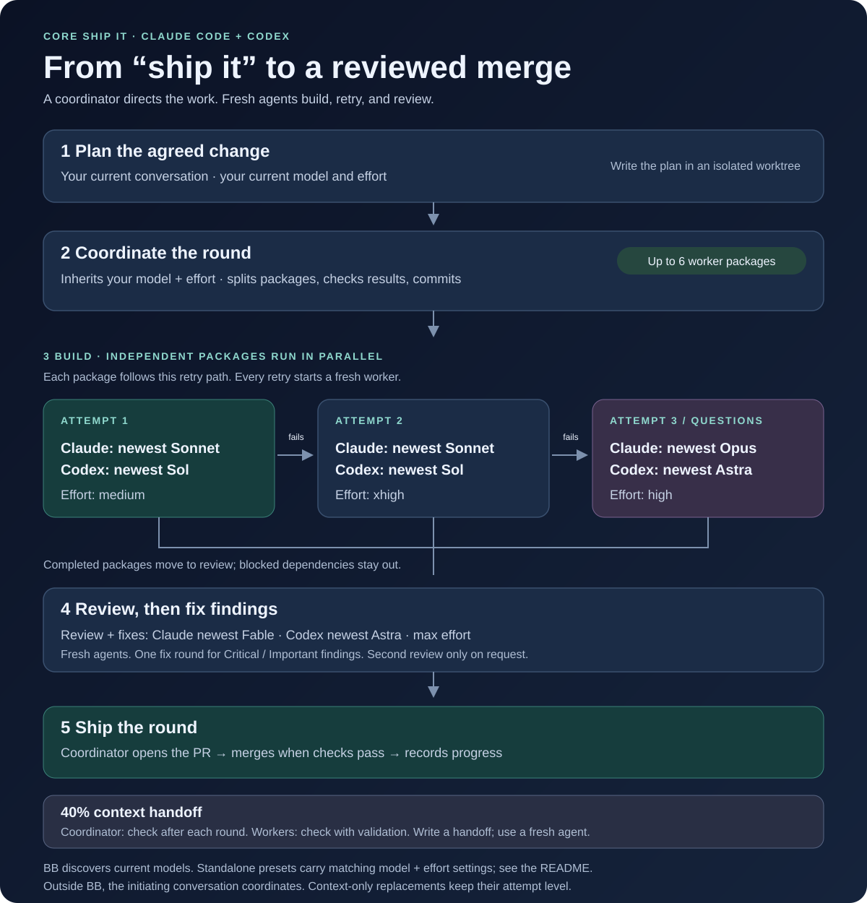

# Ship it

Say "ship it" to your coding agent about a change you've agreed on. It writes a plan, then a coordinator builds it in
rounds: cheaper-model workers in parallel, one fresh reviewer per round, then a pull request and merge.

## How it works

The current conversation writes the plan. In BB, a fresh coordinator inherits that conversation's model and reasoning
effort, divides each round into up to six packages, and delegates implementation. Independent packages run in parallel;
packages that need the same files run sequentially. The coordinator checks the workers' results and commits their work.

## Which model does each agent use?

| Agent / attempt | Claude Code | Codex | Reasoning effort |
|---|---|---|---|
| Planning conversation | Your current model | Your current model | Your current setting |
| Coordinator | Inherits your model | Inherits your model | Inherits your setting |
| Worker: attempt 1 | Sonnet (`sonnet`) | Newest available Luna | `medium` |
| Fresh worker: attempt 2 | Opus (`opus`) | Newest available Sol | `medium` |
| Fresh worker: attempt 3 | Opus (`opus`) | Newest available Sol | `xhigh` |
| Design-question worker | Opus (`opus`) | Newest available Sol | `xhigh`; starts at attempt 3 |
| Fresh reviewer | Opus (`opus`) | Newest available Sol | `high` |

**Retries are per package.** A failed or off-scope attempt goes to a fresh worker with the previous handoff and a tighter
brief. A context-only handoff keeps the same attempt level. A package that fails its third attempt is marked blocked;
independent packages can still proceed. Design questions start at the strongest tier and compare at least two designs.

**Review is independent.** One fresh reviewer checks the whole round using the included `core-code-review` skill.
Critical or Important findings go to fresh workers for one fix round. The coordinator runs the checks and then opens
and merges the pull request when it is mergeable with no failing checks; unresolved Critical issues block shipping.

**The model names depend on the environment.** In BB, the skill discovers the highest-version plain Luna and Sol IDs
from `bb provider models codex --json`; it does not pin BB workers to one version. The standalone Codex agent files
currently specify `gpt-6-luna` for workers and `gpt-6.1-sol` for reviewers. Keep those files updated as models change.
Claude Code uses the `sonnet` and `opus` aliases. Outside BB, Claude Code's Agent tool cannot set effort for retries;
the skill passes `opus` for attempts 2 and 3. The table describes the skill's intended routing, subject to the host's
available models and controls. Outside BB, the initiating conversation acts as coordinator.

**40% context handoffs.** The coordinator checks context after each round; workers check it when running their package's
validation. At the skill's 40% threshold, they write progress or a handoff for a fresh agent, keeping the work resumable.
In BB, usage comes from `bb thread context --self`; outside BB, the skill asks agents to estimate. It instructs agents
not to compact their threads.

## Install (per project)
Claude Code:
- `skills/core-ship-it` and `skills/core-code-review` go in `<project>/.claude/skills/`
- `agents/claude/*.md` go in `<project>/.claude/agents/`

Codex:
- the same two skill folders go in `<project>/.agents/skills/`
- `agents/codex/*.toml` go in `<project>/.codex/agents/`

## Needs
- git, a GitHub remote with a `main` branch, and the GitHub CLI (`gh`) logged in.
- Works best inside bb (each worker is its own thread you can watch). Outside bb it uses the tool's subagents.
- It merges to `main` on its own once checks pass. Only use it where that's OK.

## Where things go
Each ship-it works in its own copy of the repo under `~/ship-it/` (`%USERPROFILE%\ship-it\` on Windows), and deletes
it when done.

## License
MIT. See [LICENSE](LICENSE).

## Source fidelity
The skill, briefs, review skill, and agent definitions preserve the original files, including line endings,
except for personal details and machine-specific references. Names and personal paths use generic equivalents;
local sync, global Git rules, and harness maintenance references have their necessary instructions included here.
The coordinator and workers retain the original 40% context handoff rule, model choices, and workflow.
